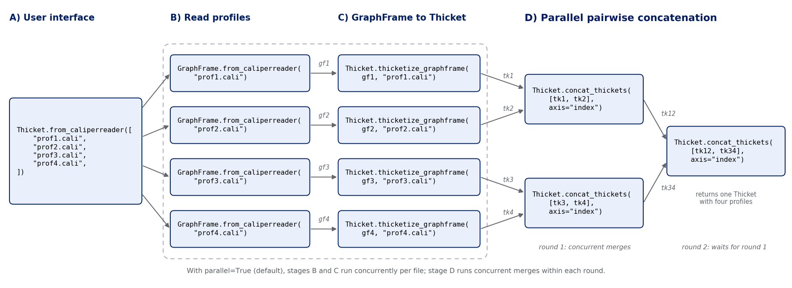

..
   Copyright 2022 Lawrence Livermore National Security, LLC and other
   Thicket Project Developers. See the top-level LICENSE file for details.

   SPDX-License-Identifier: MIT

.. _concatenating-thickets:

#######################
 Concatenating Thickets
#######################

This page describes how concatenation combines Thicket graphs, aligns profiles,
and constructs the result's attributes. It covers row and column concatenation,
node intersection, and enforced constraints. Use it when modifying concatenation
or reader code to understand how changes affect node identity, DataFrame indexes,
and profile mappings.

:meth:`Thicket.concat_thickets() <thicket.thicket.Thicket.concat_thickets>`
accepts a list of ``Thicket`` instances and returns a new ``Thicket`` with a
unified ``hatchet.Graph`` and concatenated ``pandas.DataFrame`` attributes.

.. _concat-example:

.. code-block:: python

   from thicket import Thicket

   # tk_a and tk_b are existing Thicket instances.
   combined = Thicket.concat_thickets(
       [tk_a, tk_b], axis="index", calltree="union"
   )

1. ``axis="index"`` appends rows to ``dataframe`` and ``metadata``.
2. ``axis="columns"`` aligns profiles and adds a header level to the columns
   of ``dataframe`` and ``metadata``.
3. ``calltree="union"`` retains the union graph. ``calltree="intersection"``
   filters the result using :meth:`~thicket.thicket.Thicket.intersection`.

.. _concat-unify-graphs:
.. _concat-update-nodes:

*******************
 Graph Unification
*******************

``Ensemble._unify()`` performs three operations:

1. Deep-copy the inputs and combine their ``graph`` attributes with successive
   ``hatchet.Graph.union()`` calls.
2. Compose the node mappings from those calls into a dictionary from each
   original ``id(node)`` to its node in the final graph.
3. Assign the union graph to each copy and replace its ``dataframe`` node index
   values with the mapped ``hatchet.Node`` instances.

With the default ``node_ordering=False``, ``Graph.union()`` matches nodes by
frame along matching call paths. All frame attributes participate in the
comparison. For example, ``main -> foo -> x`` and ``main -> bar -> x`` retain
separate ``x`` nodes. The result's nodes receive new ``_hatchet_nid`` values.

``Node.__eq__()`` and ``Node.__hash__()`` compare only ``_hatchet_nid``, so nodes
from different graphs can compare equal. The mapping uses ``id(node)`` to
distinguish those instances. :func:`~thicket.utils.check_same_frame` verifies
that each replacement preserves the node's frame.

Node ordering is retained only when all inputs enable it. In Hatchet v2026.2.0,
ordered unions can produce duplicate children when input traversal orders differ.

.. _concat-merge-tables:
.. _concat-by-row:

**************************************
 Row Concatenation (``axis="index"``)
**************************************

``Ensemble._index()`` concatenates ``dataframe`` and ``metadata`` along their
row indexes and sorts both results. It also:

1. Extends ``profile`` in input order and merges ``profile_mapping``, sorting
   the dictionary by profile ID.
2. Combines ``exc_metrics`` and ``inc_metrics``, removing duplicate metric
   names without preserving their order.
3. With ``fill_perfdata=True`` (default), reindexes ``dataframe`` over the
   Cartesian product of its index levels. Missing combinations receive
   ``NaN`` in numeric columns and ``None`` in string columns such as ``name``.

``fill_perfdata=False`` retains only existing rows. ``profile`` preserves input
order even though the DataFrame indexes and ``profile_mapping`` are sorted.

If inputs have different index levels, ``helpers._resolve_missing_indicies()``
adds each missing level with value ``0`` before graph unification. This modifies
the original inputs' ``dataframe`` attributes.

.. _concat-by-column:

*******************************************
 Column Concatenation (``axis="columns"``)
*******************************************

``Ensemble._columns()`` operates on deep copies and concatenates ``dataframe``
and ``metadata`` along their columns. Two arguments control alignment:

``headers``
   One label per input, used as the outer column index level. The default is
   ``0, 1, ..., len(thickets) - 1``.

``metadata_key``
   A metadata column, or the existing metadata index name, whose values become
   the profile index. Rows align on equal values. If omitted, profiles align
   by position in sorted profile order and receive integer IDs starting at zero.

For example, given CPU and GPU Thickets with a ``size`` metadata column:

.. code-block:: python

   compared = Thicket.concat_thickets(
       [cpu, gpu],
       axis="columns",
       headers=["CPU", "GPU"],
       metadata_key="size",
   )

The result has the following attributes:

1. ``dataframe`` is indexed by node and the new profile value. Its columns
   form a ``pandas.MultiIndex`` with labels such as ``("CPU", "time")`` and
   ``("GPU", "time")``. Missing input rows produce ``NaN`` values. A single
   ``("name", "")`` column contains names from the node frames.
2. ``metadata`` is indexed by the new profile value, with columns grouped by
   input header. A column used as ``metadata_key`` becomes the index.
3. ``profile`` and the keys of ``profile_mapping`` contain
   ``(profile_value, header)`` tuples. The DataFrame indexes contain only
   ``profile_value`` at the profile level.
4. ``exc_metrics`` and ``inc_metrics`` contain ``(header, metric)`` tuples.

Without ``metadata_key``, the inputs must have equal profile counts and sorted
profile indexes. Default profile IDs are hashes of file paths; their sorted
order does not establish a correspondence between experiments. Use
``metadata_key`` to align profiles by an experimental parameter.

***********************
 Aggregated Statistics
***********************

Both axes create a new ``statsframe`` referencing the result's ``graph`` and
clear ``statsframe_ops_cache``. ``statsframe.dataframe`` initially contains only
``name`` (row concatenation) or ``("name", "")`` (column concatenation).
Statistics computed on the inputs must be recomputed on the result.

.. _concat-intersection:

*******************
 Node Intersection
*******************

``calltree="intersection"`` constructs the union first, then calls
:meth:`~thicket.thicket.Thicket.intersection`. Node selection depends on the axis:

1. After row concatenation, if ``name`` contains null values, a node is retained
   when none of its ``name`` values is ``None``. Otherwise, its row count must
   equal ``len(profile)``.
2. After column concatenation, a node is retained only if all its values across
   all rows and headers are non-null. This also excludes nodes with missing
   measurements in the original inputs.

The retained rows are passed through :meth:`~thicket.thicket.Thicket.squash`,
which rebuilds the graph, renumbers nodes, and recomputes inclusive metrics.

.. _concat-readers:

********************
 Reader Integration
********************

For multiple input files, ``Thicket.reader_dispatch()`` reads each file into a
``hatchet.GraphFrame``, converts it with
:meth:`~thicket.thicket.Thicket.thicketize_graphframe`, and combines the resulting
Thickets through pairwise row concatenation. A single file skips concatenation.
The reader forwards ``fill_perfdata`` and maps ``intersection=True`` to
``calltree="intersection"``.

      and combined by two concurrent pairwise concatenations followed by a
      final concatenation after both complete.

   Reading and concatenating four Caliper profiles with parallel=True.
